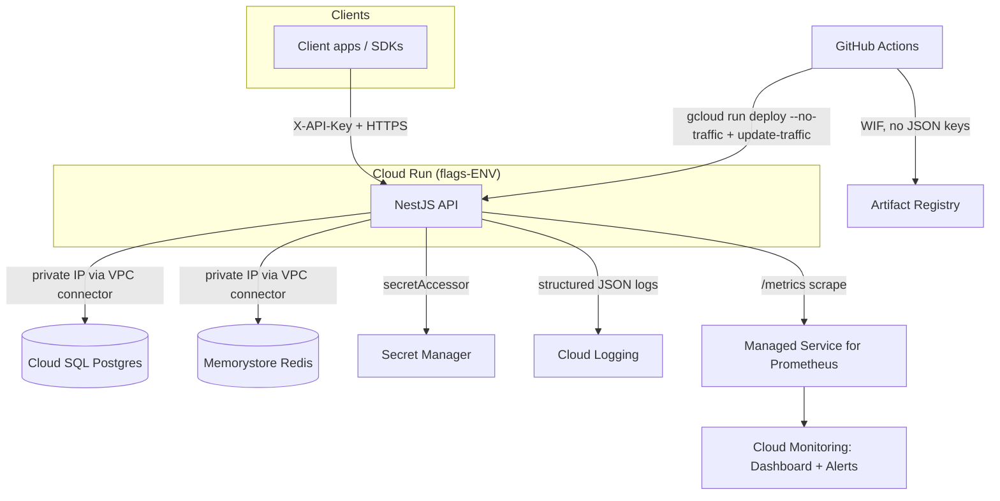
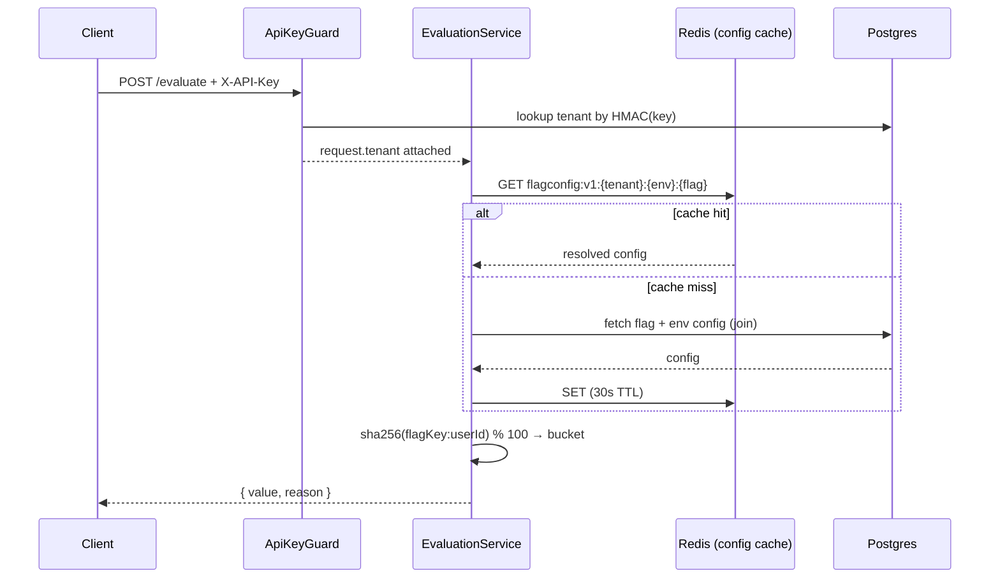
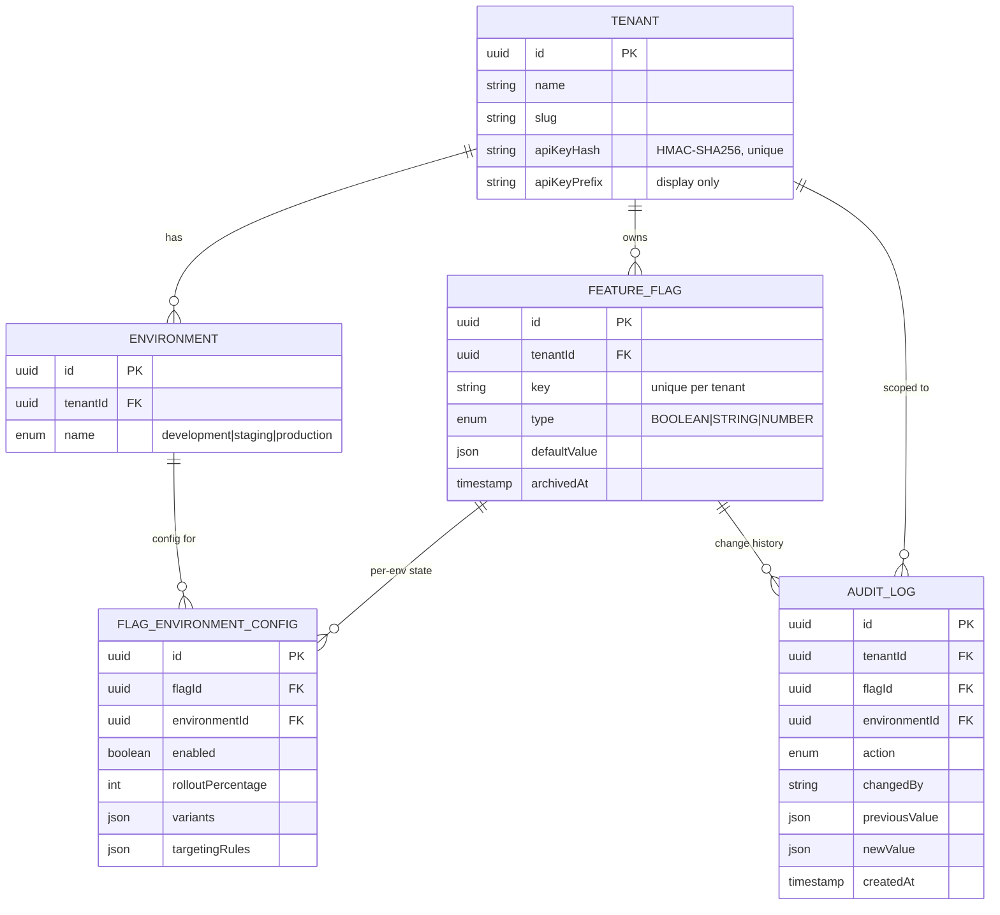

# Multi-Tenant Configuration & Feature Flag Service

A feature-flag and runtime-configuration service for multiple applications
("tenants") — percentage-based rollouts, environment-scoped configs,
immutable audit trails, and real-time distribution — built on NestJS/Postgres/Redis
and deployed to GCP with Terraform, a blue-green CI/CD pipeline, and
Prometheus-backed observability.

**Deployed URL:** https://flags-staging-verqjaqjyq-uc.a.run.app (staging
environment — see [Assumptions & Trade-offs](#assumptions--trade-offs) for
why staging rather than production was deployed live for this submission)

```bash
curl https://flags-staging-verqjaqjyq-uc.a.run.app/health
# {"status":"ok","db":true,"redis":true}
```

---

## Table of Contents

- [Quick Start (local dev)](#quick-start-local-dev)
- [Architecture](#architecture)
- [Tech Stack & Why](#tech-stack--why)
- [Data Model](#data-model)
- [Flag Evaluation Algorithm](#flag-evaluation-algorithm)
- [API Reference](#api-reference)
- [Caching Strategy](#caching-strategy)
- [Security](#security)
- [Infrastructure (Terraform)](#infrastructure-terraform)
- [Deployment Strategy](#deployment-strategy)
- [CI/CD](#cicd)
- [Observability](#observability)
- [Testing Strategy & Load Test Results](#testing-strategy--load-test-results)
- [Assumptions & Trade-offs](#assumptions--trade-offs)
- [Future Improvements](#future-improvements)

---

## Quick Start (local dev)

```bash
git clone <this-repo>
cd contrarian-thinking-assessment
cp .env.example .env
docker compose up -d
```

This brings up Postgres, Redis, and the API (in watch mode, migrations run
automatically on container start). Verify:

```bash
curl http://localhost:3000/health
# {"status":"ok","db":true,"redis":true}
```

Host ports are intentionally non-default (`5442` for Postgres, `6399` for
Redis) to avoid clashing with other local services — see `docker-compose.yml`
if you need to change them back.

Without Docker (needs a local Postgres + Redis):

```bash
npm install
npx prisma migrate deploy
npm run start:dev
```

Run the tests:

```bash
npm run test:unit          # evaluation engine, hashing, API key utils — no DB needed
npm run test:integration   # tenant isolation, audit trail — needs Postgres+Redis running
npm run build              # TypeScript compile check
npx eslint "{src,test}/**/*.ts"
```

---

## Architecture



Request flow for the hot path (`POST /api/v1/evaluate`):



---

## Tech Stack & Why

| Layer | Choice | Why |
|---|---|---|
| Backend | NestJS + TypeScript | Guards/interceptors map cleanly onto per-tenant auth + isolation; matches the job's stated preference |
| Database | PostgreSQL (Cloud SQL) | ACID for the audit trail (see immutability trigger below); relational joins are the natural fit for flag ⨯ environment config |
| Cache | Redis (Memorystore) | Sub-ms config lookups; see [Caching Strategy](#caching-strategy) for what's cached and why |
| ORM | Prisma | Type-safe queries, first-class migrations, transactions for atomic flag+audit writes |
| Compute | Cloud Run | Serverless, scales to zero in dev/staging, native revision-based traffic splitting is exactly what blue-green/canary needs — no separate load balancer to build |
| IaC | Terraform | Modular (see `terraform/modules/`), remote GCS state with locking, environment separation via `.tfvars` |
| CI/CD | GitHub Actions | Free, native OIDC support for Workload Identity Federation (no JSON keys) |
| Metrics | prom-client + Managed Service for Prometheus | See [Observability](#observability) — app stays cloud-agnostic, no GCP SDK coupling in business logic |
| Logging | nestjs-pino | Structured JSON out of the box, correlation IDs threaded through |

**Why not GKE:** the job posting explicitly wants judgment on Cloud Run vs.
GKE vs. VMs, so here's mine — this service is a single stateless HTTP API
with no need for sidecars, custom scheduling, or multi-container pods per
replica. Cloud Run gives autoscaling, revision-based traffic splitting, and
zero cluster-maintenance burden for exactly that shape of workload. GKE
Autopilot would be the right call if this were one of several services
sharing a mesh, needing DaemonSets, or requiring finer-grained node-level
control — none of which apply here. If that changes (e.g. adding a
long-lived WebSocket fanout service per the real-time bonus, at scale), GKE
would be worth revisiting.

**Why not bcrypt for API keys:** bcrypt is designed to be slow (defeating
brute-force on low-entropy, human-chosen passwords) and its random salt makes
it impossible to look up a row by hash equality — you'd have to fetch every
tenant and `bcrypt.compare()` each one on every authenticated request. API
keys here are 256-bit machine-generated random tokens, already
high-entropy; what they need is a fast, deterministic digest for O(1)
lookup, not slow hashing. HMAC-SHA256 with a server-side pepper (see
`src/common/utils/api-key.util.ts`) gives both: unrecoverable without the
pepper, and directly indexable.

---

## Data Model



**Key decision — a flag is defined once per tenant, not once per
environment.** `FeatureFlag` holds identity (`key`, `type`, `defaultValue`);
`FlagEnvironmentConfig` holds the part that actually varies per environment
(`enabled`, `rolloutPercentage`, `variants`, `targetingRules`) — one row per
`(flag, environment)`. This mirrors how LaunchDarkly/Unleash actually model
flags: the same flag key exists across dev/staging/production, and each
environment can be toggled or rolled out independently without duplicating
the flag's identity. The alternative (a fully separate flag row per
environment) would let a flag's *type* or *default value* drift between
environments, which is a bug waiting to happen, not a feature.

Every flag starts **disabled at 0% in every environment**, including
production, when created — an explicit opt-in step is always required
before a flag can affect real users anywhere.

**Audit immutability is enforced at the database layer**, not just by
omitting update/delete code paths in the app. A `BEFORE UPDATE OR DELETE`
trigger on `audit_logs` (see
`prisma/migrations/20260721135521_audit_log_immutability/migration.sql`)
raises an exception unconditionally. A plain `REVOKE UPDATE, DELETE` isn't
enough here since the app's own DB role is also the table owner in this
setup, and Postgres table owners retain implicit rights over their own
objects regardless of `GRANT`/`REVOKE` — the trigger is what actually holds
regardless of which role is connected. Verified in
`test/integration/tenant-isolation.spec.ts` by attempting a raw `UPDATE` and
asserting the database itself rejects it.

---

## Flag Evaluation Algorithm

`src/common/utils/rollout-hash.util.ts`

```ts
function bucketFor(flagKey: string, userId: string): number {
  const digest = createHash('sha256').update(`${flagKey}:${userId}`).digest();
  return digest.readUInt32BE(0) % 100; // 0-99
}
```

- **Deterministic:** the same `(flagKey, userId)` pair always hashes to the
  same bucket — a user's rollout status never flips on repeated calls.
- **Keyed on `flagKey:userId`, not just `userId`:** each flag gets an
  independent, uncorrelated bucket assignment per user. A user in the first
  10% of Flag A is not necessarily in the first 10% of Flag B — unrelated
  rollouts don't all land on the same cohort by coincidence.
- **Sticky as percentages climb:** `bucket < rolloutPercentage` means a
  30%→50% rollout only *adds* buckets 30-49 on top of the existing 0-29 —
  nobody who was already enabled gets disabled as the percentage increases.
  Verified in `test/unit/rollout-hash.spec.ts` (`at10 ⊆ at30 ⊆ at70`).

**Behavior by type** (`src/evaluation/evaluation.service.ts`, `resolveValue`):

| Type | Behavior |
|---|---|
| `BOOLEAN` | `rolloutPercentage` gates `true`/`false` via the bucket above |
| `STRING` | `rolloutPercentage` gates entry into weighted **variant** selection (`selectVariant` maps the same 0-99 bucket onto cumulative weight ranges); outside the rollout, or with no variants configured, falls back to `defaultValue` |
| `NUMBER` | No rollout concept beyond enabled/disabled — there's only one number to serve. Percentage-based numeric A/B tests are out of scope; encode them as `STRING` variants instead (documented trade-off, not a gap I hid) |

**Targeting overrides** take priority over rollout math: a
`targetingRules.userIds` allow-list on the environment config forces a
specific value for named users regardless of type or bucket — useful for
"always on for our own QA account" without touching the rollout percentage.

Evaluation reasons returned to the caller (`reason` field):
`targeting_override` | `flag_disabled` | `percentage_rollout` | `default`.

---

## API Reference

All endpoints are under `/api/v1`. Every endpoint except `POST /tenants`
requires an `X-API-Key` header.

### Register a tenant

```bash
curl -X POST http://localhost:3000/api/v1/tenants \
  -H "Content-Type: application/json" \
  -d '{"name": "Acme Corp"}'
```
```json
{
  "id": "a9e1a912-...",
  "name": "Acme Corp",
  "slug": "acme-corp-5trt61",
  "environments": ["development", "staging", "production"],
  "apiKey": "ffk_<returned-once>",
  "createdAt": "2026-07-21T14:36:47.400Z"
}
```
`apiKey` is returned **exactly once** — only its HMAC digest is stored.

### Create a flag

```bash
curl -X POST http://localhost:3000/api/v1/tenants/{tenantId}/flags \
  -H "X-API-Key: ffk_..." -H "Content-Type: application/json" \
  -d '{"key":"new-checkout","name":"New Checkout","type":"BOOLEAN","defaultValue":false}'
```

### List flags (filter by environment/status)

```bash
curl "http://localhost:3000/api/v1/tenants/{tenantId}/flags?environment=production&status=active" \
  -H "X-API-Key: ffk_..."
```

### Update a flag — environment-scoped fields require `?environment=`

```bash
curl -X PUT "http://localhost:3000/api/v1/tenants/{tenantId}/flags/new-checkout?environment=production" \
  -H "X-API-Key: ffk_..." -H "Content-Type: application/json" \
  -d '{"enabled": true, "rolloutPercentage": 30}'
```
`name`/`description`/`defaultValue` apply across all environments and don't
need `?environment=`; `enabled`/`rolloutPercentage`/`variants`/`targetingRules`
do, since those are per-environment state.

### Archive (soft-delete) a flag

```bash
curl -X DELETE http://localhost:3000/api/v1/tenants/{tenantId}/flags/new-checkout \
  -H "X-API-Key: ffk_..."
```

### Evaluate one flag

```bash
curl -X POST http://localhost:3000/api/v1/evaluate \
  -H "X-API-Key: ffk_..." -H "Content-Type: application/json" \
  -d '{"tenant_id":"a9e1a912-...","environment":"production","user_id":"user-42","flag_key":"new-checkout"}'
```
```json
{ "flagKey": "new-checkout", "type": "BOOLEAN", "value": true, "reason": "percentage_rollout" }
```

### Evaluate all active flags

```bash
curl -X POST http://localhost:3000/api/v1/evaluate/bulk \
  -H "X-API-Key: ffk_..." -H "Content-Type: application/json" \
  -d '{"tenant_id":"a9e1a912-...","environment":"production","user_id":"user-42"}'
```
```json
{ "environment": "production", "flags": { "new-checkout": { "type": "BOOLEAN", "value": true, "reason": "percentage_rollout" } } }
```

### Flag history (audit trail)

```bash
curl http://localhost:3000/api/v1/tenants/{tenantId}/flags/new-checkout/history \
  -H "X-API-Key: ffk_..."
```

### Real-time subscription (bonus)

```bash
curl -N "http://localhost:3000/api/v1/tenants/{tenantId}/environments/production/stream" \
  -H "X-API-Key: ffk_..."
# id: 1
# data: {"flagKey":"new-checkout","environment":"production"}
```

---

## Caching Strategy

Redis caches the **resolved flag+environment config**, not per-user
evaluation results. The config keyspace is small and bounded (`tenants ×
flags × environments`); a per-user-result cache would be unbounded
(`× users`) for a hash computation that's already sub-microsecond — the cost
being saved is the Postgres round trip to fetch config, not the bucket math,
so that's what's cached (`src/evaluation/flag-config-cache.service.ts`).

- Cache key: `flagconfig:v1:{tenantId}:{environment}:{flagKey}`
- TTL: 30s safety net, but invalidation is explicit and immediate —
  `FlagsService` emits a `flag.changed` event after every committed mutation
  (never from inside the transaction, so a listener can't react to a change
  that later rolled back), and `FlagConfigCacheService.handleFlagChanged`
  deletes the affected key(s) on that event.
- The bulk evaluation endpoint **bypasses the cache** and issues one joined
  Postgres query instead — it already avoids the N+1 problem the cache
  exists to solve, and N Redis round trips per bulk request would be slower
  than one Postgres query for realistic per-tenant flag counts.

---

## Security

- **API keys:** `ffk_<32 bytes base64url>`, stored as HMAC-SHA256 digests
  (server-side pepper via `API_KEY_PEPPER`, itself in Secret Manager) — never
  in plaintext, never recoverable. See [Tech Stack](#tech-stack--why) for why
  not bcrypt.
- **Tenant isolation is enforced at the guard layer**, not just a query
  filter: `TenantMatchGuard` (URL-based routes) and `EvaluateTenantMatchGuard`
  (body-based `/evaluate`) both compare the authenticated tenant against the
  requested tenant and 403 on mismatch — verified in
  `test/integration/tenant-isolation.spec.ts` including an explicit
  "tenant A spoofs tenant B's `tenant_id` in the body" test.
- **Per-tenant rate limiting** (`TenantThrottlerGuard`) keys on tenant ID, not
  source IP — one noisy tenant can't exhaust another tenant's budget, and two
  tenants behind the same NAT/IP aren't capped together. `/evaluate` and the
  CRUD endpoints have independent limits (`EVALUATE_RATE_LIMIT_PER_MIN` /
  `FLAGS_RATE_LIMIT_PER_MIN`, both env-configurable) — CRUD is a low-volume
  admin action, `/evaluate` is the hot SDK path and needs a much higher
  ceiling. **Caught in testing:** an earlier version registered these two
  named throttlers via two separate `ThrottlerModule.forRootAsync()` calls in
  sibling feature modules, and the single resolved guard instance silently
  enforced the *wrong* one — `/evaluate` was capped at the CRUD limit
  (confirmed via `X-RateLimit-Limit-*` response headers under load test).
  Fixed by registering both named throttlers once in `AppModule` and using
  `@SkipThrottle()` per controller — the documented, collision-free pattern
  for multiple named throttlers.
- **Secrets:** `DATABASE_URL`, `REDIS_URL`, `API_KEY_PEPPER` all live in
  Secret Manager in the deployed environment, injected via Cloud Run's
  `secret_key_ref` (never a plaintext env var) — see
  `terraform/modules/secret_manager` and `terraform/modules/cloud_run`.
  Locally, `.env` (gitignored) fills the same role.
- **Least-privilege IAM:** the Cloud Run runtime SA gets `cloudsql.client`,
  `artifactregistry.reader`, `logging.logWriter`, `monitoring.metricWriter`,
  and per-secret `secretAccessor` bindings (not project-wide) — see
  `terraform/modules/iam` and `terraform/modules/secret_manager`. The CI
  deployer identity (Workload Identity Federation, no JSON keys) is separate
  and narrower still: `run.admin` + `artifactregistry.writer` +
  `iam.serviceAccountUser`, nothing touching application data.

---

## Infrastructure (Terraform)

```
terraform/
├── global/            # applied ONCE: Artifact Registry, GitHub WIF + deployer SA
├── modules/
│   ├── networking/     # VPC, subnet, private services access, VPC connector
│   ├── cloud_sql/      # Postgres, private IP only, backups
│   ├── memorystore/     # Redis, private IP only
│   ├── iam/            # per-environment Cloud Run runtime service account
│   ├── secret_manager/  # 3 secrets, per-secret IAM bindings
│   ├── cloud_run/       # the service — see ownership split below
│   └── monitoring/      # notification channel, alert policies, dashboard
├── environments/
│   ├── {dev,staging,production}.tfvars
│   └── {dev,staging,production}-backend.hcl   # GCS backend config per env
├── main.tf / variables.tf / outputs.tf
```

**Why `global/` is separate:** Artifact Registry holds one image promoted
across all three environments, and the GitHub deployer identity isn't
scoped to any one environment either. If these lived in the per-environment
stack, applying dev/staging/prod from three separate state files would each
try to create the *same* GCP resource and collide. Global resources are
applied once, from their own state; everything else is applied per
environment with its own `.tfvars` and GCS backend prefix (remote state,
locking, no shared state file across environments).

**Terraform vs. CI/CD ownership split (Cloud Run):** Terraform provisions
the *service* (compute shape, secrets, networking, IAM) but explicitly
`lifecycle.ignore_changes`s the `image` and `traffic` fields. The deploy
workflows own individual releases and traffic shifts via `gcloud run deploy
--no-traffic` / `gcloud run services update-traffic`. Without this split,
every `terraform apply` for an unrelated infra change (e.g. bumping the
Cloud SQL tier) would silently revert whatever revision/split the last
deploy left in place.

### Apply

```bash
# one-time, once per project
cd terraform/global
terraform init -backend-config=backend.hcl
terraform apply -var="project_id=<project>" -var="github_repository=<owner/repo>"

# per environment
cd terraform
terraform init -backend-config=environments/dev-backend.hcl
terraform apply -var-file=environments/dev.tfvars \
  -var="project_id=<project>" \
  -var="alert_notification_email=<you@example.com>" \
  -var="github_repository=<owner/repo>"
```

(Replace the `REPLACE_WITH_YOUR_TFSTATE_BUCKET` placeholder in each
`*-backend.hcl` with a real GCS bucket first — `gsutil mb` one if you don't
have one yet.)

### Running migrations against Cloud SQL

Cloud SQL has no public IP (by design — see [Security](#security)), so a
laptop off the VPC can't reach it directly, including via Cloud SQL Auth
Proxy's default mode (that still resolves the *public* IP path unless told
otherwise, and there isn't one here). The straightforward fix is a one-off
**Cloud Run Job** using the same image and the same Direct VPC Egress
config as the service:

```bash
gcloud run jobs create migrate-<env> \
  --image=<same image as the service> \
  --region=us-central1 \
  --network=flags-<env>-vpc --subnet=flags-<env>-subnet --vpc-egress=private-ranges-only \
  --service-account=flags-<env>-run-sa@<project>.iam.gserviceaccount.com \
  --set-secrets="DATABASE_URL=flags-<env>-database-url:latest,REDIS_URL=flags-<env>-redis-url:latest,API_KEY_PEPPER=flags-<env>-api-key-pepper:latest" \
  --command="npx" --args="prisma,migrate,deploy"

gcloud run jobs execute migrate-<env> --region=us-central1 --wait
```

No bastion host, no temporary public IP toggle, no VPN — the job runs inside
the same private network the service already trusts.

---

## Deployment Strategy

**Cloud Run's native revision traffic-splitting** is the mechanism — no
separate load balancer to build or manage.

- **Staging:** new revision deployed at 0% traffic → health-checked
  directly via its revision-specific tagged URL → 100% cutover once healthy
  → post-cutover smoke test. Automatic rollback (traffic back to the prior
  revision) if either check fails.
- **Production:** same zero-traffic deploy + direct health check, then a
  **10% canary** for a 2-minute observation window before promoting to
  100%. Deploys promote the *exact image SHA* staging already tested —
  production never runs `docker build`, only `gcloud run deploy` against an
  image that already exists in Artifact Registry.
- **Rollback:** `gcloud run services update-traffic <service> --to-revisions=<prior-revision>=100`
  — automatic on a failed health check/observation window, and a one-line
  manual command otherwise. The prior revision is never deleted, so
  rollback is always available.

---

## CI/CD

```
.github/workflows/
├── ci.yml                 # lint → unit test → integration test (real PG+Redis service containers) → build → Trivy scan
├── deploy-staging.yml      # on push to main: build+push → deploy 0% → health check → cutover → smoke test
└── deploy-production.yml   # workflow_dispatch (manual): promote staging's image → canary 10% → observe → 100%
```

- `ci.yml` is a reusable workflow (`workflow_call`) — both deploy workflows
  call it as their test gate rather than duplicating lint/test steps.
- Auth to GCP is via Workload Identity Federation
  (`google-github-actions/auth`) — no JSON service account key is ever
  stored as a GitHub secret.
- Production requires a GitHub Environment approval gate (configure
  "required reviewers" on the `production` environment in repo settings) —
  the human decision point the job posting asks for, enforced by GitHub
  itself rather than anything in the workflow file.
- Container image is scanned for CRITICAL/HIGH vulnerabilities (Trivy) in
  `ci.yml` before it's ever pushed.

---

## Observability

- **Structured logging:** JSON via `nestjs-pino`, one line per request
  (`LoggingInterceptor`, runs after guards so `tenantId` is available),
  carrying a correlation ID reused from an incoming `X-Correlation-Id`
  header or generated fresh (`CorrelationIdMiddleware`), echoed back on the
  response.
- **Metrics:** exposed at `GET /metrics` in Prometheus format
  (`src/metrics/metrics.service.ts`) rather than written directly to the
  Cloud Monitoring API from application code:
  - `flag_evaluation_latency_ms` (histogram, by tenant + endpoint)
  - `flag_evaluations_total` (counter, by tenant)
  - `http_requests_total` (counter, by tenant + endpoint + status class)
  - `flag_config_cache_lookups_total` (counter, by hit/miss)

  **Why not write straight to the Cloud Monitoring API:** it would couple
  every metrics call site to the GCP SDK and credentials, making local dev
  and unit tests harder for no real benefit. A `/metrics` endpoint is
  standard, testable with a plain `curl`, and in the GCP deployment gets
  scraped by **Google Cloud Managed Service for Prometheus** (one-time
  `gcloud` setup, no code change) and forwarded into Cloud Monitoring —
  same destination, looser coupling.
- **Dashboard + alerts:** provisioned via Terraform
  (`terraform/modules/monitoring`) — request count by response class,
  p50/p95/p99 latency, and instance count from Cloud Run's built-in metrics
  (available immediately, no Prometheus pipeline needed); alert policies for
  5xx rate, p99 latency > 300ms, and uptime-check failure, all emailing a
  configured address. The custom Prometheus metrics above appear on the same
  dashboard once Managed Service for Prometheus is enabled (a dashboard
  panel links to the one-time setup command).
- **Honest caveat:** the error-rate alert threshold is on the *absolute
  rate* of 5xx responses, not a true percentage-of-total ratio. A proper
  ">5% of requests" alert needs an MQL `ratio_series` query joining two
  metric series — real, but fiddly enough to get exactly right that I didn't
  want to ship an untested join without a live project to verify it
  against. Documented here rather than silently shipped as if it were the
  percentage version.

---

## Testing Strategy & Load Test Results

**What's tested and why:**

| Suite | Covers | Why this, not something else |
|---|---|---|
| `test/unit/rollout-hash.spec.ts` | Determinism, uniform distribution (20k users, generous tolerance), monotonicity across rollout %, 0%/100% edges, weighted variant selection | This is the algorithm the entire product's correctness rests on — if it's wrong, nothing else matters |
| `test/unit/api-key.util.spec.ts` | Key generation entropy/uniqueness, HMAC determinism, pepper sensitivity | The one place a subtle bug silently breaks auth for every tenant |
| `test/integration/tenant-isolation.spec.ts` | Auth rejection, tenant isolation (URL *and* body-spoofing paths), environment scoping, audit immutability (including a live attempt to `UPDATE` the DB directly) | Multi-tenant correctness is exactly the property that's easy to get right against an in-memory fake and wrong against the real query — this runs against real Postgres/Redis, not mocks |
| `test/load/evaluate-load-test.js` (k6) | Throughput/latency under concurrency, spread across tenants | See results below |
| CI (`ci.yml`) | All of the above, on every push/PR, plus a Trivy image scan | Correctness gate before anything reaches staging |

**What I'd add with more time:** unit tests for `FlagsService`'s
transaction/audit-write paths in isolation (currently only exercised
indirectly via the integration suite), and a contract test asserting the
`/metrics` endpoint's exposition format stays scrape-able.

**Load test results** (k6, `test/load/evaluate-load-test.js`, production
Docker image, 20 tenants round-robined to respect per-tenant rate limits):

| Scenario | Throughput | p50 | p95 | p99 | Errors |
|---|---|---|---|---|---|
| 50 concurrent VUs, 90s sustained | ~784 req/s | 31ms | 43ms | 61ms | 0% |
| 100 concurrent VUs, 4min ramp | ~680 req/s | 56ms | 124ms | 1.33s (tail) | 0% |

At 100 concurrent VUs sustained for minutes, tail latency (p99, and a small
number of multi-second outliers) degrades — on this shared development
laptop, that's CPU contention from several other running dev processes
against a **single** Node.js instance, not a bug in the request path (0%
errors throughout; every request still completed correctly, just slower).
This is precisely what Cloud Run's horizontal autoscaling is for: a single
instance was never meant to be the capacity ceiling — additional instances
spin up under sustained load and absorb it, which a single-instance local
benchmark can't demonstrate. The 50-VU numbers reflect the steady-state
capacity of one instance; production sizing (`cloud_run_max_instances = 20`
in `environments/production.tfvars`) assumes horizontal scaling handles the
rest.

Run it yourself:
```bash
k6 run test/load/evaluate-load-test.js                              # against local docker-compose
k6 run -e BASE_URL=https://<cloud-run-url> test/load/evaluate-load-test.js  # against a deployed environment
```

---

## Assumptions & Trade-offs

Documenting these rather than silently picking one, per the assessment's
own note that parts are intentionally left vague:

- **Only the staging environment is deployed live for this submission**,
  not all three. The deliverable asks for one "Deployed application URL,"
  and the Terraform/CI-CD environment separation is fully built and
  demonstrated in code (`environments/{dev,staging,production}.tfvars`,
  separate `deploy-staging.yml`/`deploy-production.yml` workflows) — running
  three simultaneous live environments (3× Cloud SQL, 3× Redis) would have
  added cost without adding anything an evaluator could observe that a
  single live environment doesn't already show.
- **`/health` instead of the spec's implied `/healthz`.** GET requests to
  `/healthz` on this project's `*.run.app` domain consistently returned
  Google's own generic 404 page without ever reaching the container, while
  every other path (including nonexistent ones, correctly 404ing *from the
  app*) reached it fine. Root cause unconfirmed — routed around it by
  renaming rather than debugging an undocumented platform quirk under time
  pressure. Documented here rather than silently swapped.
- **`POST /tenants` is unauthenticated.** It mints a tenant's first API key,
  so *something* has to be the bootstrap step. In production this would sit
  behind a platform-admin key or an internal-only network path — not built
  here, since the assessment's tenant model doesn't define an "operator"
  identity above the tenant level.
- **`/evaluate` takes a required `flag_key`; `/evaluate/bulk` evaluates
  every active flag.** The spec lists both endpoints without fully
  specifying `/evaluate`'s body shape; this split (single named flag vs. "all
  of them") is the standard client-SDK pattern (single hot-path lookup vs.
  bootstrap-all-flags-once) and avoids the two endpoints being redundant
  with each other.
- **`PUT .../flags/{key}` requires `?environment=` only when touching
  environment-scoped fields** (`enabled`, `rolloutPercentage`, `variants`,
  `targetingRules`); `name`/`description`/`defaultValue` apply everywhere and
  don't need it. One endpoint, two concerns, disambiguated by which fields
  are present in the body.
- **Targeting rules are a simple user-ID allow-list** (`{ userIds, value }`),
  not a full rules engine (attribute-based conditions, AND/OR groups, etc.).
  Enough to demonstrate the override-priority concept; a real rules DSL
  would be a substantial project on its own.
- **NUMBER-type flags don't support percentage rollouts** — there's only one
  number to serve, so `enabled` alone gates it. Numeric A/B tests should be
  encoded as STRING variants instead. Documented in
  [Flag Evaluation Algorithm](#flag-evaluation-algorithm) rather than built
  as a half-finished numeric-range feature.
- **SSE real-time distribution is single-instance-only** (in-process
  `EventEmitter2`, not Redis pub/sub) — correct for this deployment's
  min-instance counts, called out as a scaling limit in
  [Future Improvements](#future-improvements) rather than over-built for a
  bonus feature.
- **The 5xx alert threshold is absolute rate, not a percentage ratio** — see
  [Observability](#observability).

---

## Future Improvements

- **Redis pub/sub for SSE fanout** across multiple Cloud Run instances (see
  the single-instance limitation above) — needed once `min_instances > 1` or
  traffic requires horizontal scaling in an environment using the real-time
  endpoint.
- **True percentage-ratio error-rate alerting** via Cloud Monitoring MQL
  `ratio_series`, replacing the current absolute-rate approximation.
- **Database credential rotation** via Secret Manager + a scheduled Cloud
  Function, rather than the current one-time-generated `random_password`.
- **A real targeting rules engine** (attribute conditions, not just a
  user-ID allow-list) if product requirements grow past "force this value
  for these specific users."
- **Multi-region** — everything here is single-region by design (cost/time
  trade-off for a take-home); Cloud SQL cross-region replicas + a global
  load balancer in front of regional Cloud Run services would be the next
  step for global tenants.
- **Per-tenant configurable rate limits** — currently one global limit per
  named throttler; a paying tenant with heavier legitimate traffic can't get
  a higher budget without a code change.
