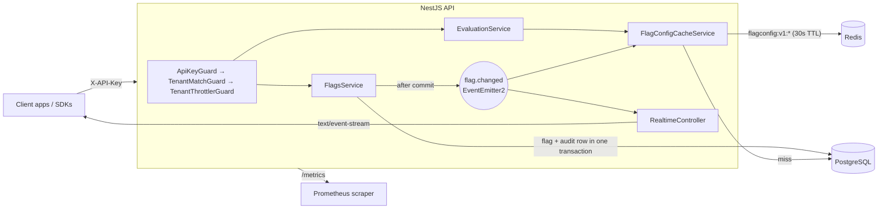
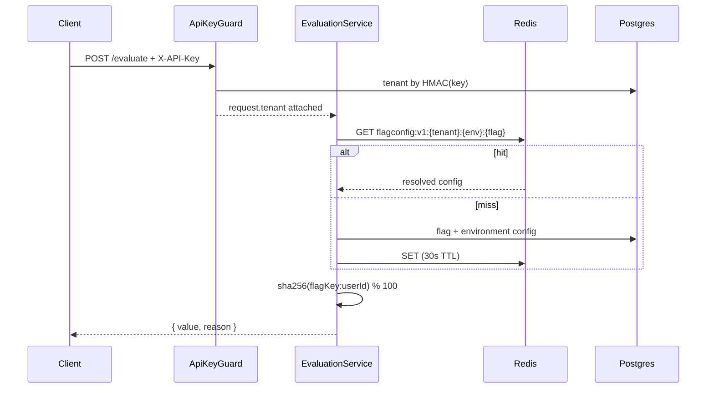
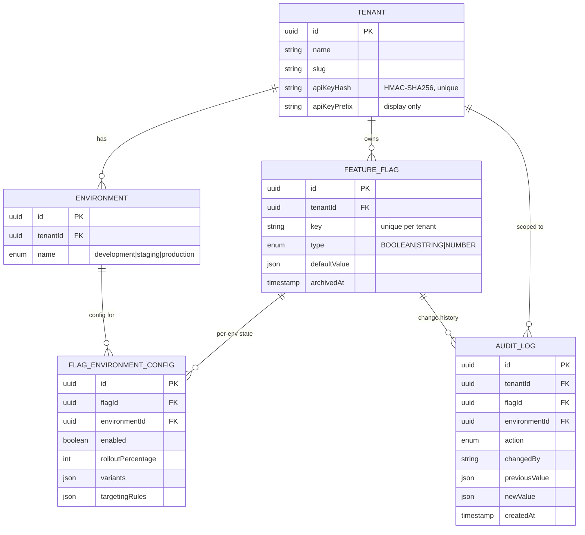

# Multi-Tenant Configuration & Feature Flag Service

A feature-flag and runtime-configuration service for multiple applications
("tenants"). Each tenant gets its own API key, three environments
(development, staging, production), typed flags with percentage rollouts and
weighted variants, an append-only audit trail, and a server-sent-events
stream that tells connected clients when a flag changed.

It is a NestJS API on PostgreSQL (Prisma) and Redis, packaged as a
multi-stage Docker image, with Terraform for a Cloud Run deployment on GCP.

What makes it more than CRUD over a flags table:

- **Deterministic, sticky rollouts.** `sha256(flagKey:userId) % 100` puts a
  user in the same bucket on every call, and raising a rollout from 30% to
  50% only *adds* users.
- **Tenant isolation as an access-control boundary**, enforced by guards on
  both URL-scoped and body-scoped routes, and tested against a real database.
- **An audit log the database itself refuses to modify.** A trigger rejects
  any `UPDATE` or `DELETE` on `audit_logs`, whichever role is connected.
- **A config cache that is invalidated precisely**, by an event emitted only
  after the mutating transaction commits.

## Contents

- [Quick start](#quick-start)
- [Walkthrough with real responses](#walkthrough-with-real-responses)
- [Architecture](#architecture)
- [Data model](#data-model)
- [Flag evaluation](#flag-evaluation)
- [API reference](#api-reference)
- [Caching](#caching)
- [Security](#security)
- [Observability](#observability)
- [Testing](#testing)
- [Infrastructure (Terraform)](#infrastructure-terraform)
- [Releasing to Cloud Run](#releasing-to-cloud-run)
- [Trade-offs and limits](#trade-offs-and-limits)
- [Future improvements](#future-improvements)

## Quick start

Requirements: Docker with Compose v2. Node 22 (`.nvmrc`) is only needed if
you want to run the API outside Docker.

```bash
git clone <this-repo> feature-flag-service
cd feature-flag-service
cp .env.example .env
docker compose up -d --build --wait
curl http://localhost:3000/health
# {"status":"ok","db":true,"redis":true}
```

This starts Postgres 16, Redis 7 and the API in watch mode. Migrations run
automatically when the API container starts. Host ports are deliberately
non-default for the datastores (`5442` for Postgres, `6399` for Redis) so
they don't clash with local instances; change them in `docker-compose.yml`
if needed.

Build, lint and test inside the running API container:

```bash
docker compose exec api npm run build
docker compose exec api npm run lint
docker compose exec api npm run test:unit          # no database needed
docker compose exec api npm run test:integration   # uses the compose Postgres + Redis
```

Stop everything and delete the data volume:

```bash
docker compose down -v
```

Without Docker you need a local Postgres and Redis matching `.env`, then
`npm ci && npx prisma migrate deploy && npm run start:dev`.

## Walkthrough with real responses

Everything below was captured from the Compose stack above. The API key is
shortened to its first 6 and last 4 characters, and long responses are trimmed
where marked.

**1. Register a tenant.** This is the only unauthenticated endpoint. The raw
key is returned once; only its HMAC digest is stored.

```bash
curl -X POST http://localhost:3000/api/v1/tenants \
  -H 'Content-Type: application/json' -d '{"name":"Acme Storefront"}'
```

```json
{
  "id": "be05bb20-91ae-45ca-8f02-8130c240c750",
  "name": "Acme Storefront",
  "slug": "acme-storefront-194ssf",
  "environments": ["development", "staging", "production"],
  "apiKey": "ffk_Ln...qfuM",
  "createdAt": "2026-11-08T05:20:05.017Z"
}
```

**2. Create a flag.** It starts disabled at 0% in every environment.

```bash
export TID=be05bb20-91ae-45ca-8f02-8130c240c750 KEY=ffk_...
curl -X POST http://localhost:3000/api/v1/tenants/$TID/flags \
  -H "X-API-Key: $KEY" -H 'Content-Type: application/json' \
  -d '{"key":"new-checkout","name":"New checkout","type":"BOOLEAN","defaultValue":false}'
```

```json
{
  "id": "8ad1b778-b59b-4ce7-b663-94cc5cd10a26",
  "key": "new-checkout",
  "type": "BOOLEAN",
  "defaultValue": false,
  "archivedAt": null,
  "environmentConfigs": [
    { "environmentId": "8667b0ce-...", "enabled": false, "rolloutPercentage": 0, "variants": null, "targetingRules": null },
    { "environmentId": "02dbe36c-...", "enabled": false, "rolloutPercentage": 0, "variants": null, "targetingRules": null },
    { "environmentId": "9ae11fee-...", "enabled": false, "rolloutPercentage": 0, "variants": null, "targetingRules": null }
  ]
}
```
(trimmed: ids, timestamps, `tenantId`)

**3. Subscribe to changes** in production before changing anything:

```bash
curl -N http://localhost:3000/api/v1/tenants/$TID/environments/production/stream -H "X-API-Key: $KEY"
```

**4. Roll it out to 30% of production**, and give a STRING flag two weighted
variants:

```bash
curl -X PUT "http://localhost:3000/api/v1/tenants/$TID/flags/new-checkout?environment=production" \
  -H "X-API-Key: $KEY" -H 'Content-Type: application/json' \
  -d '{"enabled":true,"rolloutPercentage":30}'

curl -X PUT "http://localhost:3000/api/v1/tenants/$TID/flags/checkout-copy?environment=production" \
  -H "X-API-Key: $KEY" -H 'Content-Type: application/json' \
  -d '{"enabled":true,"rolloutPercentage":100,"variants":[{"value":"Pay now","weight":1},{"value":"Complete order","weight":1}]}'
```

The open stream receives one event per change:

```text
id: 1
data: {"flagKey":"new-checkout","environment":"production"}

id: 2
data: {"flagKey":"checkout-copy","environment":"production"}
```

`environment` is `null` when the change was to a flag-wide field (name,
description, `defaultValue`); those reach subscribers of every environment.

**5. Evaluate for a user.** Six users against the 30% rollout:

```bash
curl -X POST http://localhost:3000/api/v1/evaluate \
  -H "X-API-Key: $KEY" -H 'Content-Type: application/json' \
  -d "{\"tenant_id\":\"$TID\",\"environment\":\"production\",\"user_id\":\"user-4\",\"flag_key\":\"new-checkout\"}"
```

```text
user-1 {"flagKey":"new-checkout","type":"BOOLEAN","value":false,"reason":"default"}
user-2 {"flagKey":"new-checkout","type":"BOOLEAN","value":false,"reason":"default"}
user-3 {"flagKey":"new-checkout","type":"BOOLEAN","value":false,"reason":"default"}
user-4 {"flagKey":"new-checkout","type":"BOOLEAN","value":true,"reason":"percentage_rollout"}
user-5 {"flagKey":"new-checkout","type":"BOOLEAN","value":false,"reason":"default"}
user-6 {"flagKey":"new-checkout","type":"BOOLEAN","value":true,"reason":"percentage_rollout"}
```

Repeating a call returns the same answer: the bucket depends only on the flag
key and user id.

**6. Evaluate everything at once** (what an SDK does on start-up):

```bash
curl -X POST http://localhost:3000/api/v1/evaluate/bulk \
  -H "X-API-Key: $KEY" -H 'Content-Type: application/json' \
  -d "{\"tenant_id\":\"$TID\",\"environment\":\"production\",\"user_id\":\"user-1\"}"
```

```json
{
  "environment": "production",
  "flags": {
    "new-checkout": { "type": "BOOLEAN", "value": false, "reason": "default" },
    "checkout-copy": { "type": "STRING", "value": "Pay now", "reason": "percentage_rollout" }
  }
}
```

**7. Read the audit trail**, newest first. `changedBy` is the 8-character
display prefix of the key that made the change.

```bash
curl http://localhost:3000/api/v1/tenants/$TID/flags/new-checkout/history -H "X-API-Key: $KEY"
```

```json
[
  {
    "action": "ENV_CONFIG_UPDATE",
    "changedBy": "ffk_Lnto",
    "previousValue": { "enabled": false, "variants": null, "targetingRules": null, "rolloutPercentage": 0 },
    "newValue": { "enabled": true, "rolloutPercentage": 30 },
    "createdAt": "2026-11-08T05:20:05.679Z",
    "environment": { "name": "production" }
  },
  {
    "action": "FLAG_CREATE",
    "changedBy": "ffk_Lnto",
    "previousValue": null,
    "newValue": { "key": "new-checkout", "name": "New checkout", "type": "BOOLEAN", "defaultValue": false },
    "createdAt": "2026-11-08T05:20:05.107Z",
    "environment": null
  }
]
```
(trimmed: `id`, `tenantId`, `flagId`, `environmentId`)

**8. What the guards and validation return:**

```text
# tenant A's key, tenant B's tenant_id in the body
HTTP/1.1 403 Forbidden
{"message":"tenant_id does not match the authenticated tenant","error":"Forbidden","statusCode":403}

# PUT ...?environment=prod
{"message":"Validation failed (enum string is expected)","error":"Bad Request","statusCode":400}

# evaluating a flag after DELETE (archive)
{"message":"Flag \"checkout-copy\" not found for this tenant/environment","error":"Not Found","statusCode":404}
```

## Architecture



The hot path, `POST /api/v1/evaluate`:



The GCP target that `terraform/` provisions: Cloud Run reaching Cloud SQL and
Memorystore over private IP through a VPC connector, secrets from Secret
Manager, logs to Cloud Logging, and dashboards and alerts in Cloud Monitoring.

| Layer | Choice | Why |
|---|---|---|
| API | NestJS 11 + TypeScript | Guards and interceptors map directly onto per-tenant auth, isolation and instrumentation |
| Database | PostgreSQL 16 | ACID for flag + audit writes; the flag × environment shape is relational |
| ORM | Prisma 6 | Typed queries, migrations, interactive transactions |
| Cache | Redis 7 (ioredis) | Sub-millisecond config lookups on the evaluation path |
| Logging | nestjs-pino | Structured JSON with a correlation id per request |
| Metrics | prom-client | `/metrics` stays cloud-agnostic; any Prometheus scraper can read it |
| Compute | Cloud Run | One stateless HTTP service; revision traffic splitting covers blue-green and canary without a separate load balancer |
| IaC | Terraform | Modules per concern, GCS remote state per environment |

**Why not GKE:** this is a single stateless HTTP API with no need for
sidecars, custom scheduling or multi-container pods. Cloud Run gives
autoscaling and revision-based traffic splitting with no cluster to run. GKE
Autopilot would be worth it once there are several services sharing a mesh,
or a long-lived WebSocket fan-out tier at scale.

## Data model



**A flag is defined once per tenant, not once per environment.**
`FeatureFlag` holds identity (`key`, `type`, `defaultValue`);
`FlagEnvironmentConfig` holds what actually varies (`enabled`,
`rolloutPercentage`, `variants`, `targetingRules`), one row per
`(flag, environment)`. This is how LaunchDarkly and Unleash model it. A
separate flag row per environment would let a flag's type or default drift
between environments, which is a bug waiting to happen.

**Audit immutability is enforced by the database**, not only by the absence
of update/delete code paths. A `BEFORE UPDATE OR DELETE` trigger on
`audit_logs` (`prisma/migrations/20260721135521_audit_log_immutability`)
raises unconditionally. `REVOKE` alone is not enough here, because the app
role also owns the table and Postgres owners keep implicit rights. The
integration suite issues a raw `UPDATE` and `DELETE` and asserts the trigger's
error.

## Flag evaluation

`src/common/utils/rollout-hash.util.ts`:

```ts
export function bucketFor(flagKey: string, userId: string): number {
  const digest = createHash('sha256').update(`${flagKey}:${userId}`).digest();
  return digest.readUInt32BE(0) % 100; // 0-99
}
```

- **Deterministic:** the same `(flagKey, userId)` always lands in the same
  bucket.
- **Independent per flag:** keying on `flagKey:userId` instead of `userId`
  means the first 10% of flag A is not also the first 10% of flag B.
- **Monotonic:** `bucket < rolloutPercentage`, so raising the percentage only
  adds buckets. The unit suite checks `at10 ⊆ at30 ⊆ at70` over 5,000 users.

Resolution order (`resolveValue` in `src/evaluation/evaluation.service.ts`):

1. A `targetingRules.userIds` match returns `targetingRules.value` (or the
   default) with reason `targeting_override`, even if the flag is disabled.
2. A disabled environment returns `defaultValue` with `flag_disabled`.
3. Otherwise, by type:

| Type | Behaviour |
|---|---|
| `BOOLEAN` | `true` with `percentage_rollout` inside the rollout, `false` with `default` outside it |
| `STRING` | Inside the rollout, a weighted variant is picked from the same bucket (weights are relative); outside it, or with no variants, `defaultValue` |
| `NUMBER` | `defaultValue`; `enabled` is the only gate. Numeric A/B tests should be modelled as STRING variants |

Variants are accepted only on STRING flags, and every variant value must be a
string.

## API reference

All routes except `/health` and `/metrics` are under `/api/v1`. Every route
except `POST /tenants` requires `X-API-Key`.

| Method | Path | Notes |
|---|---|---|
| `POST` | `/tenants` | `{ name }`, returns the API key once |
| `POST` | `/tenants/:tenantId/flags` | `{ key, name, description?, type, defaultValue }`; 409 on a duplicate key |
| `GET` | `/tenants/:tenantId/flags` | `?environment=` and `?status=active\|archived` filters |
| `PUT` | `/tenants/:tenantId/flags/:flagKey` | Flag-wide fields (`name`, `description`, `defaultValue`) need no query; `enabled`, `rolloutPercentage`, `variants`, `targetingRules` need `?environment=` |
| `DELETE` | `/tenants/:tenantId/flags/:flagKey` | Archives (soft delete); archived flags stop evaluating |
| `GET` | `/tenants/:tenantId/flags/:flagKey/history` | Audit entries, newest first |
| `POST` | `/evaluate` | `{ tenant_id, environment, user_id, flag_key }` |
| `POST` | `/evaluate/bulk` | `{ tenant_id, environment, user_id }`, all active flags |
| `GET` | `/tenants/:tenantId/environments/:environment/stream` | SSE change notifications |
| `GET` | `/health` | 200 when Postgres and Redis answer, 503 otherwise |
| `GET` | `/metrics` | Prometheus text format |

`/evaluate` carries `tenant_id` in the body because SDKs post one payload
shape to both evaluate endpoints. `EvaluateTenantMatchGuard` rejects a body
`tenant_id` that differs from the key's tenant. Unknown environment names are
a 400 everywhere.

## Caching

Redis caches the **resolved flag + environment config**, not per-user
results. The config keyspace is bounded (`tenants × flags × environments`);
a per-user cache would be unbounded, and it would save a hash computation
that already takes under a microsecond. The cost worth saving is the Postgres
round trip (`src/evaluation/flag-config-cache.service.ts`).

- Key: `flagconfig:v1:{tenantId}:{environment}:{flagKey}`, 30 s TTL as a
  safety net.
- Invalidation is explicit: `FlagsService` emits `flag.changed` after the
  transaction commits (never from inside it, so nothing reacts to a rollback),
  and the cache deletes the affected keys. A flag-wide change clears all three
  environments even if it arrived with `?environment=`.
- `/evaluate/bulk` skips the cache and runs one joined query. That already
  avoids N+1, and N Redis round trips would be slower for realistic flag
  counts.

The hit/miss ratio is exported as `flag_config_cache_lookups_total`. In the
walkthrough above it was 6 hits and 2 misses.

## Security

- **API keys** are `ffk_` + 32 random bytes (base64url), stored only as
  HMAC-SHA256 with a server-side pepper (`API_KEY_PEPPER`). I chose HMAC over
  bcrypt on purpose: bcrypt's random salt makes lookup by hash impossible, so
  every request would need a scan-and-compare across tenants. Its slowness
  also defends low-entropy passwords, which these 256-bit tokens are not.
- **Keys never reach the logs:** pino redacts `X-API-Key` and `Authorization`
  from the request it attaches to each log line.
- **Tenant isolation** is enforced by `TenantMatchGuard` (URL routes) and
  `EvaluateTenantMatchGuard` (body routes). The integration suite includes
  tenant A reading tenant B's URL and spoofing B's `tenant_id`.
- **Per-tenant rate limits** (`TenantThrottlerGuard`) key on tenant id, not
  IP, with separate budgets for CRUD (`FLAGS_RATE_LIMIT_PER_MIN`, default 120)
  and evaluation (`EVALUATE_RATE_LIMIT_PER_MIN`, default 3000). Both named
  throttlers are registered once in `AppModule`, with `@SkipThrottle` per
  controller. An earlier version registered them in two feature modules, and
  `/evaluate` silently enforced the CRUD limit; load testing exposed it through
  the `X-RateLimit-Limit-*` headers.
- **In GCP**, `DATABASE_URL`, `REDIS_URL` and `API_KEY_PEPPER` live in Secret
  Manager with per-secret accessor bindings, and Cloud SQL and Memorystore have
  private IPs only. The runtime service account gets `cloudsql.client`,
  `artifactregistry.reader`, `logging.logWriter` and `monitoring.metricWriter`.
  Locally `.env` (git-ignored) plays the same role. `.env.example` holds only
  development placeholders.

## Observability

- **Logs:** one JSON line per request from `LoggingInterceptor`: method,
  route, tenant, status, latency and correlation id. The id is reused from an
  incoming `X-Correlation-Id` or generated, and echoed on the response. It runs
  after guards, so `tenantId` is present. Requests rejected by a guard are not
  logged there. An SSE stream is logged once, when it opens.
- **Metrics** at `GET /metrics` (`src/metrics/metrics.service.ts`), sampled
  from the walkthrough:

  ```text
  # TYPE flag_evaluation_latency_ms histogram
  flag_evaluation_latency_ms_count{tenant_id="be05bb20-...",endpoint="evaluate"} 7
  # TYPE flag_evaluations_total counter
  flag_evaluations_total{tenant_id="be05bb20-..."} 8
  # TYPE http_requests_total counter
  http_requests_total{tenant_id="be05bb20-...",endpoint="POST /api/v1/evaluate",status_class="2xx"} 7
  http_requests_total{tenant_id="be05bb20-...",endpoint="POST /api/v1/evaluate",status_class="4xx"} 1
  # TYPE flag_config_cache_lookups_total counter
  flag_config_cache_lookups_total{result="hit"} 6
  flag_config_cache_lookups_total{result="miss"} 2
  ```

  I expose Prometheus metrics instead of writing to the Cloud Monitoring API
  from application code. That keeps the GCP SDK and credentials out of
  business logic and local tests. In GCP, Managed Service for Prometheus can
  scrape the endpoint into Cloud Monitoring.
- **Dashboard and alerts** (`terraform/modules/monitoring`): request count by
  response class, p50/p95/p99 latency and instance count from Cloud Run's
  built-in metrics, plus alerts for 5xx rate, p99 > 300 ms and uptime-check
  failure, sent to a configured email. The 5xx alert uses an absolute rate,
  not a percentage of traffic (see trade-offs).

## Testing

| Suite | Covers |
|---|---|
| `test/unit/rollout-hash.spec.ts` | Determinism, uniform distribution over 20k users, monotonic rollouts, 0%/100% edges, weighted variants |
| `test/unit/resolve-value.spec.ts` | Resolution order and reasons for every flag type, including targeting overrides on disabled flags |
| `test/unit/api-key.util.spec.ts` | Key format and uniqueness, HMAC determinism, pepper sensitivity |
| `test/unit/metrics.service.spec.ts` | Exact Prometheus series names and labels |
| `test/unit/logging.interceptor.spec.ts` | SSE streams counted once, regular requests logged with tenant |
| `test/integration/tenant-isolation.spec.ts` | Auth rejection, URL and body tenant spoofing, environment scoping, audit trail and the immutability trigger |
| `test/integration/flag-lifecycle.spec.ts` | Archived flags stop evaluating, cross-environment cache invalidation, variant validation, unknown environments, concurrent duplicate creates, SSE delivery per environment |
| `test/load/evaluate-load-test.js` | k6: `/evaluate` under ramping concurrency across 20 tenants |

Unit tests need nothing running. Integration tests boot the full `AppModule`
against real Postgres and Redis rather than mocks, because tenant isolation is
easy to get right against a fake and wrong against the real query.

Load test, against the Compose stack or a deployed URL (needs
[k6](https://k6.io), or its Docker image):

```bash
k6 run test/load/evaluate-load-test.js
k6 run -e BASE_URL=https://<service-url> test/load/evaluate-load-test.js
```

Earlier runs against the production image on a single instance, on a shared
development laptop:

| Scenario | Throughput | p50 | p95 | p99 | Errors |
|---|---|---|---|---|---|
| 50 VUs, 90 s sustained | ~784 req/s | 31 ms | 43 ms | 61 ms | 0% |
| 100 VUs, 4 min ramp | ~680 req/s | 56 ms | 124 ms | 1.33 s | 0% |

At 100 VUs the p99 tail came from CPU contention on one Node process, not
from errors. Horizontal scaling (`cloud_run_max_instances = 20` in production)
is what absorbs that. Rate limits are per tenant, which is why the script
spreads load over 20 tenants instead of measuring the limiter.

## Infrastructure (Terraform)

```
terraform/
├── global/              # applied once: Artifact Registry + deployer identity
├── modules/
│   ├── networking/      # VPC, subnet, private services access, VPC connector
│   ├── cloud_sql/       # Postgres, private IP only, backups
│   ├── memorystore/     # Redis, private IP only
│   ├── iam/             # per-environment Cloud Run runtime service account
│   ├── secret_manager/  # 3 secrets with per-secret IAM bindings
│   ├── cloud_run/       # the service (image and traffic deliberately ignored)
│   └── monitoring/      # notification channel, alert policies, dashboard
├── environments/        # {dev,staging,production}.tfvars + *-backend.hcl
└── main.tf / variables.tf / outputs.tf
```

**`global/` is a separate stack** because Artifact Registry holds one image
promoted through every environment, and the deployer identity is not
per-environment. In the per-environment stack, three state files would each
try to create the same resource. See `terraform/global/README.md`.

**Terraform owns the service, not the release.** The Cloud Run module sets
`lifecycle.ignore_changes` on `image` and `traffic`. Otherwise a `terraform
apply` for an unrelated change, such as a bigger Cloud SQL tier, would roll
back whatever revision and traffic split the last release left in place.

```bash
# once per project
cd terraform/global
terraform init -backend-config=backend.hcl
terraform apply -var="project_id=<project>" -var="github_repository=<owner/repo>"

# per environment
cd terraform
terraform init -backend-config=environments/dev-backend.hcl
terraform apply -var-file=environments/dev.tfvars \
  -var="project_id=<project>" -var="alert_notification_email=<you@example.com>"
```

Replace `REPLACE_WITH_YOUR_TFSTATE_BUCKET` in each `*-backend.hcl` first. Both
stacks pass `terraform fmt -check` and `terraform validate` (Terraform 1.9).

**Migrations against Cloud SQL.** It has no public IP, so run them as a
one-off Cloud Run Job on the same network and service account:

```bash
gcloud run jobs create migrate-<env> \
  --image=<same image as the service> --region=us-central1 \
  --network=flags-<env>-vpc --subnet=flags-<env>-subnet --vpc-egress=private-ranges-only \
  --service-account=flags-<env>-run-sa@<project>.iam.gserviceaccount.com \
  --set-secrets="DATABASE_URL=flags-<env>-database-url:latest,REDIS_URL=flags-<env>-redis-url:latest,API_KEY_PEPPER=flags-<env>-api-key-pepper:latest" \
  --command="npx" --args="prisma,migrate,deploy"
gcloud run jobs execute migrate-<env> --region=us-central1 --wait
```

## Releasing to Cloud Run

The `runtime` stage of the Dockerfile is the deployable image: production
dependencies only, a non-root user, and a `HEALTHCHECK` against `/health`.

```bash
docker build --target runtime -t us-central1-docker.pkg.dev/<project>/feature-flag-service/api:<sha> .
docker push us-central1-docker.pkg.dev/<project>/feature-flag-service/api:<sha>
```

Revision traffic splitting gives blue-green and canary releases:

```bash
# 1. new revision at 0% traffic, reachable on its own tagged URL
gcloud run deploy flags-<env> --image=<image>:<sha> --region=us-central1 --no-traffic --tag=candidate
curl https://candidate---<service-url>/health

# 2. production: a 10% canary first, then full cutover
gcloud run services update-traffic flags-<env> --region=us-central1 --to-tags=candidate=10
gcloud run services update-traffic flags-<env> --region=us-central1 --to-latest

# rollback: the previous revision is never deleted
gcloud run services update-traffic flags-<env> --region=us-central1 --to-revisions=<previous-revision>=100
```

Promote the exact image digest that ran in staging, rather than rebuilding
for production. On SIGTERM, `enableShutdownHooks()` lets in-flight requests
and the Prisma and Redis connections finish while traffic moves away.

## Trade-offs and limits

- **`POST /tenants` is unauthenticated.** It mints a tenant's first key, so
  something has to be the bootstrap step. In production it belongs behind a
  platform-admin credential or an internal-only path; the model has no
  operator identity above tenants yet.
- **`/health`, not `/healthz`.** On `*.run.app`, requests to `/healthz` were
  answered by Google's front end with a 404 before reaching the container, so
  the probe path avoids it.
- **`/evaluate` takes one `flag_key`; `/evaluate/bulk` returns all active
  flags.** This mirrors the usual SDK split: hot-path lookup versus
  bootstrap-everything.
- **Targeting is a user-id allow-list** (`{ userIds, value }`), not an
  attribute rules engine. The evaluate DTO already accepts a `context` object,
  but nothing reads it yet.
- **NUMBER flags have no rollout.** `enabled` alone gates them; use STRING
  variants for numeric experiments.
- **SSE fan-out is in-process** (`EventEmitter2`). A change only reaches
  clients connected to the instance that handled it. That is fine at one
  instance; beyond that it needs Redis pub/sub.
- **The 5xx alert uses an absolute rate.** A true "> 5% of requests" alert
  needs an MQL ratio query. I didn't want to ship that join untested, without
  a live project to check it against.
- **Guard rejections (401/403) are not in the request log or metrics**,
  because the interceptor runs after guards.

## Future improvements

- Redis pub/sub for SSE across instances.
- Ratio-based error-rate alerting.
- Rotation for the database password (currently a one-time `random_password`).
- A real targeting rules engine using the evaluate `context`.
- Per-tenant configurable rate limits.
- Multi-region: Cloud SQL cross-region replicas behind a global load balancer.

## License

MIT, see [LICENSE](LICENSE).
